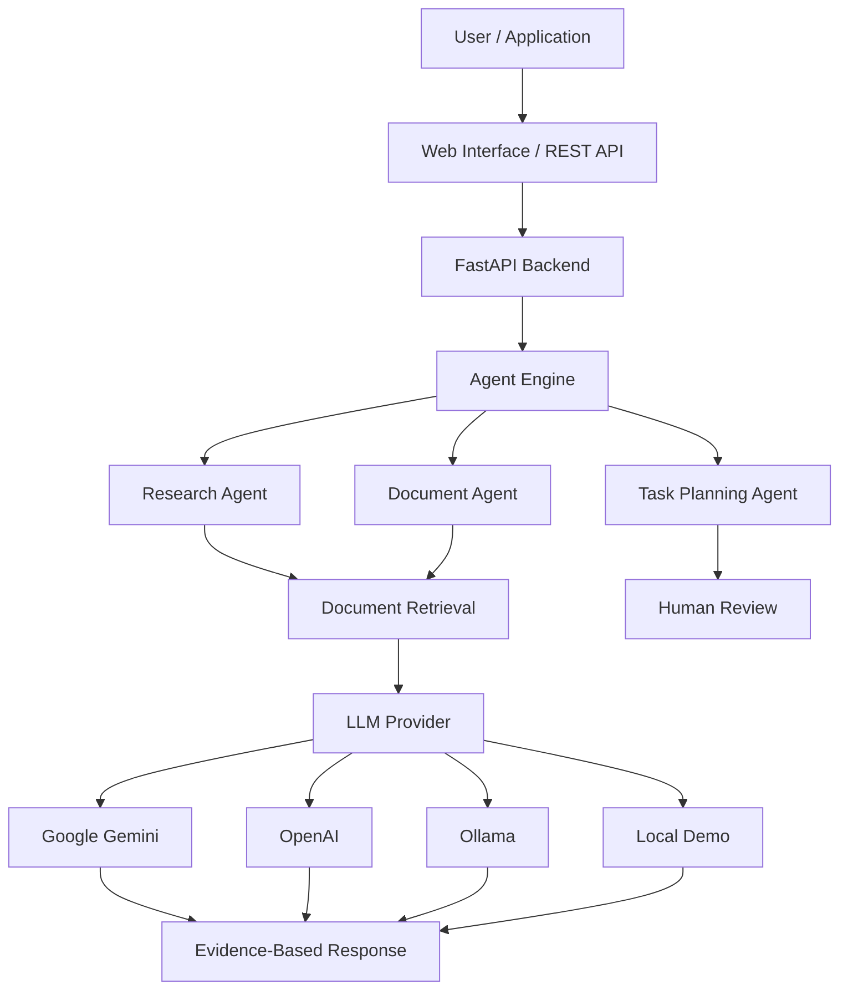

# VAF AI Agent Starter Kit

Build AI-powered research assistants, document intelligence applications and task planning workflows using Python, FastAPI, Google Gemini, OpenAI and Ollama.

The AI Agent Starter Kit provides a lightweight and reusable foundation for developers who want to integrate AI into their applications without building everything from scratch.

Developed by [VAF](https://vaf.ai/).


---

## Overview

This project demonstrates how AI agents can retrieve information, understand document content and generate evidence-backed responses using configurable Large Language Models (LLMs).

The application supports multiple AI providers through a common interface, allowing developers to switch between cloud-based and locally hosted models.

A built-in demo mode allows users to explore the application without requiring an API key.

## Key Features

| Feature                  | Description                                                    |
| ------------------------ | -------------------------------------------------------------- |
| Research Agent           | Retrieves relevant information from a collection of documents. |
| Document Intelligence    | Answers questions based on supplied document content.          |
| Task Planning Agent      | Generates draft task plans for human review.                   |
| Multi-LLM Support        | Supports Google Gemini, OpenAI and Ollama.                     |
| Evidence-Based Responses | Provides references to retrieved source documents.             |
| Demo Mode                | Runs locally without an API key.                               |
| Web Interface            | Simple browser-based interface for interacting with agents.    |
| REST API                 | Easily integrates with external applications.                  |
| Swagger Documentation    | Interactive API documentation and testing.                     |
| Docker Configuration     | Supports container-based local deployment.                     |

---

## Architecture



## Technology Stack

| Component            | Technology                    |
| -------------------- | ----------------------------- |
| Programming Language | Python                        |
| Backend Framework    | FastAPI                       |
| Frontend             | HTML, CSS, JavaScript         |
| AI Models            | Google Gemini, OpenAI, Ollama |
| API Documentation    | Swagger / OpenAPI             |
| Document Retrieval   | Keyword-Based Retrieval       |
| Testing              | Pytest                        |
| Deployment           | Docker                        |
| CI/CD                | GitHub Actions                |

---

## Getting Started

### Prerequisites

- Python 3.12
- Git
- API key for cloud-based AI models (optional)
- Docker (optional)

### 1. Clone the Repository

```bash
git clone https://github.com/GunalanVaf/ai-agent-starter-kit.git

cd ai-agent-starter-kit
```

### 2. Create a Virtual Environment

```bash
python -m venv .venv
```

Activate the virtual environment.

**Windows Git Bash:**

```bash
source .venv/Scripts/activate
```

**Windows PowerShell:**

```powershell
.venv\Scripts\Activate.ps1
```

**Linux / macOS:**

```bash
source .venv/bin/activate
```

### 3. Install Dependencies

```bash
python -m pip install -r requirements.txt
```

### 4. Run the Application

```bash
python -m uvicorn app.main:app --host 127.0.0.1 --port 8000
```

### 5. Access the Application

| Application     | URL                          |
| --------------- | ---------------------------- |
| AI Agent Studio | http://127.0.0.1:8000        |
| Swagger API     | http://127.0.0.1:8000/docs   |
| Health Check    | http://127.0.0.1:8000/health |

The application runs in demo mode by default. No API key is required to get started.

---

## AI Model Configuration

Choose your preferred AI provider and configure the corresponding environment variables.

### Google Gemini

Generate your API key from [Google AI Studio](https://aistudio.google.com/apikey).

```bash
export ENABLE_LLM=true
export GEMINI_MODEL=gemini-3.5-flash-lite

read -s -p "Enter Gemini API key: " GEMINI_API_KEY
export GEMINI_API_KEY
echo
```

Start the application and select **Google Gemini** from the provider dropdown.

`gemini-3.5-flash-lite` was successfully tested with live API requests. Model availability may vary depending on your Google API project.

### OpenAI

Generate your API key from the [OpenAI Platform](https://platform.openai.com/api-keys).

```bash
export ENABLE_LLM=true
export OPENAI_MODEL=gpt-4o-mini

read -s -p "Enter OpenAI API key: " OPENAI_API_KEY
export OPENAI_API_KEY
echo
```

Start the application and select **OpenAI** from the provider dropdown.

### Ollama

Download and install [Ollama](https://ollama.com/).

Download a compatible model:

```bash
ollama pull llama3.2
```

Configure the environment variables:

```bash
export ENABLE_LLM=true
export OLLAMA_URL=http://localhost:11434
export OLLAMA_MODEL=llama3.2
```

Start the application and select **Ollama** from the provider dropdown.

Ollama allows developers to run AI models locally without a cloud API key.

> Environment variables must be configured in the same terminal that starts the application. Restart the server after changing the configuration. The `.env.example` file is provided as a reference and is not automatically loaded.

---

## Available AI Agents

### 1. Research Agent

The Research Agent retrieves relevant information from the available document collection and returns responses with source references.

**Example question:**

What are the steps for legacy migration?

**Example response:**

- Dependency inventory
- Compatibility assessment
- Automated testing
- Rollback planning

**Use cases:**

- Technical research
- Knowledge management
- Business research
- Procurement document analysis

### 2. Document Intelligence Agent

The Document Intelligence Agent answers questions based on document content provided by the user.

**Example document:**

The enterprise modernization project has a budget of INR 25 lakhs and an implementation duration of six months.

**Example question:**

What is the project budget and implementation duration?

**Example response:**

- Project Budget: INR 25 lakhs
- Implementation Duration: Six months

**Use cases:**

- Document analysis
- Requirement extraction
- Business document review
- Internal knowledge assistants

### 3. Task Planning Agent

The Task Planning Agent generates a structured draft checklist for a given objective.

**Example question:**

Prepare a plan to migrate a legacy Java application to Python FastAPI.

**Example workflow:**

1. Understand the migration objective.
2. Identify required inputs and permissions.
3. Prepare proposed actions.
4. Submit the plan for human review.

The current Task Planning Agent uses deterministic planning logic. It does not execute external actions automatically.

---

## API Reference

### Run Agent

**Endpoint**

```http
POST /v1/agents/run
```

### Research Agent Request

```json
{
  "question": "What are the steps for legacy migration?",
  "mode": "research",
  "provider": "gemini",
  "documents": null
}
```

### Example Response

```json
{
  "agent": "research",
  "answer": "Dependency inventory, compatibility assessment, automated tests and rollback planning.",
  "sources": ["migration-guide"],
  "steps": ["Retrieve relevant evidence", "Return evidence-backed response"],
  "status": "completed"
}
```

### Document Agent Request

```json
{
  "question": "What is the project budget?",
  "mode": "document",
  "provider": "gemini",
  "documents": [
    {
      "id": "project-001",
      "text": "The project budget is INR 25 lakhs."
    }
  ]
}
```

### Task Planning Agent Request

```json
{
  "question": "Prepare an application migration plan",
  "mode": "task",
  "provider": "demo"
}
```

### Supported Parameters

| Parameter | Description                            |
| --------- | -------------------------------------- |
| question  | User question or task objective.       |
| mode      | research, document or task.            |
| provider  | demo, gemini, openai or ollama.        |
| documents | Optional collection of text documents. |

Use `demo` instead of `gemini` to test the API without configuring an API key.

---

## Project Structure

```text
ai-agent-starter-kit/
│
├── app/
│   ├── __init__.py
│   ├── main.py
│   ├── engine.py
│   └── demo.html
│
├── docs/
│   ├── architecture.md
│   └── publishing.md
│
├── examples/
│   └── documents.json
│
├── tests/
│   └── test_app.py
│
├── .github/
│   └── workflows/
│       └── ci.yml
│
├── .env.example
├── .gitignore
├── .dockerignore
├── Dockerfile
├── compose.yaml
├── requirements.txt
├── requirements-dev.txt
├── CONTRIBUTING.md
├── SECURITY.md
├── CHANGELOG.md
└── README.md
```

## Running Tests

Install the development dependencies:

```bash
python -m pip install -r requirements-dev.txt
```

Run the automated test suite:

```bash
python -m pytest -v tests/test_app.py
```

Version 0.1.2 includes 17 automated tests covering agent execution, input validation, provider request formats and error handling.

Automated tests use mocked AI provider responses and do not require paid API access.

## Docker Deployment

Build and start the application:

```bash
docker compose up --build
```

Access the application at:

```text
http://localhost:8000
```

The provided Docker configuration starts the application in local demo mode.

---

## Real-World Applications

This starter kit can be extended to support various business and enterprise applications.

| Industry             | Potential Application                                 |
| -------------------- | ----------------------------------------------------- |
| Government           | Citizen information assistants and document analysis. |
| Enterprise           | Internal knowledge management and AI assistants.      |
| Procurement          | Tender and requirement analysis.                      |
| Software Development | Technical research and migration planning.            |
| Education            | Document-based learning assistants.                   |
| Business Operations  | Task planning and information extraction.             |

---

## Troubleshooting

| Issue                | Solution                                                            |
| -------------------- | ------------------------------------------------------------------- |
| 403 Forbidden        | Enable LLM access using `ENABLE_LLM=true` or select demo mode.      |
| 502 Bad Gateway      | Check provider connectivity, model availability, quota and timeout. |
| API Key Missing      | Configure your API key in the server terminal.                      |
| Model Not Found      | Select a model available to your API account.                       |
| No Matching Evidence | Provide relevant document content.                                  |
| Request Timeout      | Try an available lightweight model.                                 |

For Gemini, `gemini-3.5-flash-lite` was successfully tested in the local development environment.

## Security and Limitations

- API keys are configured through environment variables.
- No API keys or confidential client information are included.
- External AI model calls are disabled by default.
- Document retrieval currently uses keyword matching rather than vector search.
- LLM-generated responses may contain inaccuracies.
- Cloud providers receive the question and relevant document content.
- Task planning does not execute external actions.
- Authentication and production-grade access controls must be added before public deployment.

Live Gemini execution and the research workflow have been verified. OpenAI and Ollama adapters are included, but live execution and Docker builds remain unverified.

## Roadmap

- [x] Research Agent
- [x] Document Intelligence Agent
- [x] Task Planning Agent
- [x] Google Gemini Integration
- [x] OpenAI Adapter
- [x] Ollama Adapter
- [x] FastAPI REST API
- [x] Browser-Based Interface
- [x] Automated Test Suite
- [ ] Configurable Provider Timeout
- [ ] Advanced Error Handling
- [ ] Vector Database Integration
- [ ] Retrieval-Augmented Generation (RAG)
- [ ] PDF and DOCX Processing
- [ ] Persistent Agent Memory
- [ ] Multi-Agent Collaboration
- [ ] Advanced Tool Calling

---

## Contributing

Contributions, suggestions and improvements are welcome.

Developers can participate by:

- Reporting bugs.
- Suggesting new features.
- Improving documentation.
- Adding AI provider integrations.
- Improving test coverage.
- Submitting pull requests.

Please refer to [CONTRIBUTING.md](CONTRIBUTING.md) for contribution guidelines.

## About VAF

VAF focuses on developing technology solutions that help organizations modernize applications, automate business processes and integrate artificial intelligence into their operations.

Our capabilities include:

- Artificial Intelligence and Generative AI
- AI Agent Development
- Enterprise Application Development
- API and System Integration
- Workflow Automation
- Cloud and Application Modernization
- Data Engineering

For enterprise solutions, custom development, AI integration and business collaboration, visit:

**Website:** [https://vaf.ai/](https://vaf.ai/)

## License

Refer to the repository's LICENSE file for usage and redistribution terms.

---

**Developed by VAF**

Building intelligent, scalable and reusable technology solutions.

If you find this project useful, consider giving it a star, contributing or sharing it with the developer community.
