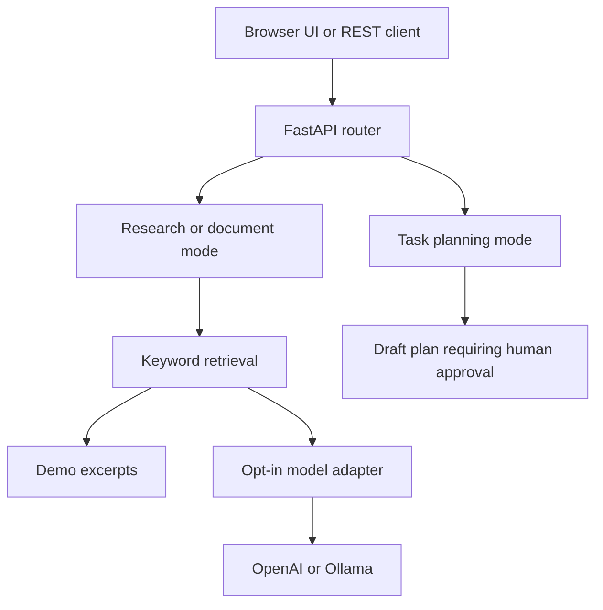

# Architecture

Requests are stateless. Documents are provided inline or read from bundled examples. The top three matching documents are selected using token overlap. No files, URLs, or external tools are accepted from the model. Provider configuration is server-side only. The task mode is deterministic and has no execution endpoint. Future work: authenticating users, provider quotas, persistence, PDF ingestion, semantic retrieval, tool registry, approval persistence and evaluation.
